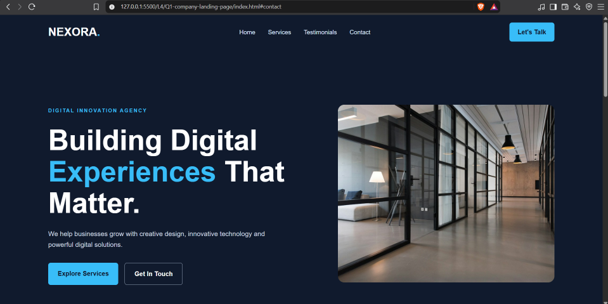

# NEXORA – Digital Solutions

A modern, responsive corporate landing page built using HTML5 and CSS3.

## 🌐 Project Overview

NEXORA is a fictional digital solutions company website designed to demonstrate advanced CSS Grid, Flexbox and responsive web design techniques.

## ✨ Features

- Responsive navigation bar
- Full-screen hero section
- Three service cards
- Client testimonials
- Contact section
- Professional footer
- Responsive layouts across desktop, tablet and mobile

## 🛠️ Technologies Used

- HTML5
- CSS3
- CSS Grid
- Flexbox
- Media Queries

## 📱 Responsive Breakpoints

| Device | Breakpoint |
|---|---|
| Tablet | 1024px |
| Small tablet | 768px |
| Mobile | 550px |

## 🚀 How to Run

1. Clone this repository.
2. Open the `Q1-company-landing-page` folder.
3. Open `index.html` in your browser.

No additional dependencies are required.

## 📂 Project Structure

```text
Q1-company-landing-page/
├── index.html
├── style.css
├── README.md
├── screenshot.png
└── assets/
    └── images/
```

## 📸 Website Preview



## 👨‍💻 Author

Created as part of Level 4 Corporate CSS Grid and Git Practice.
